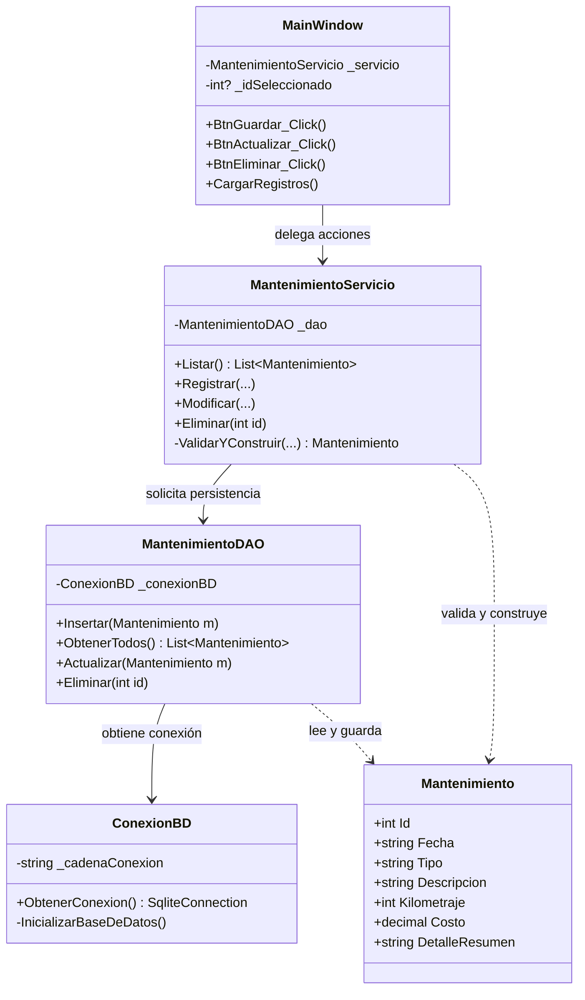
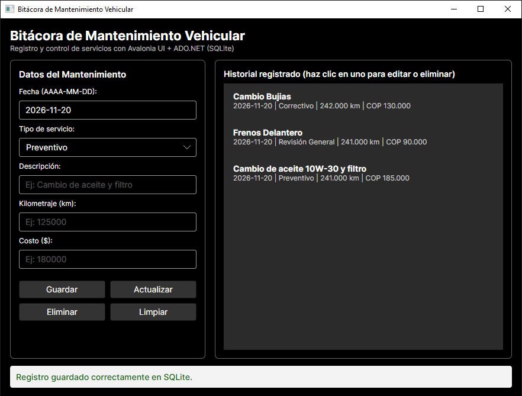
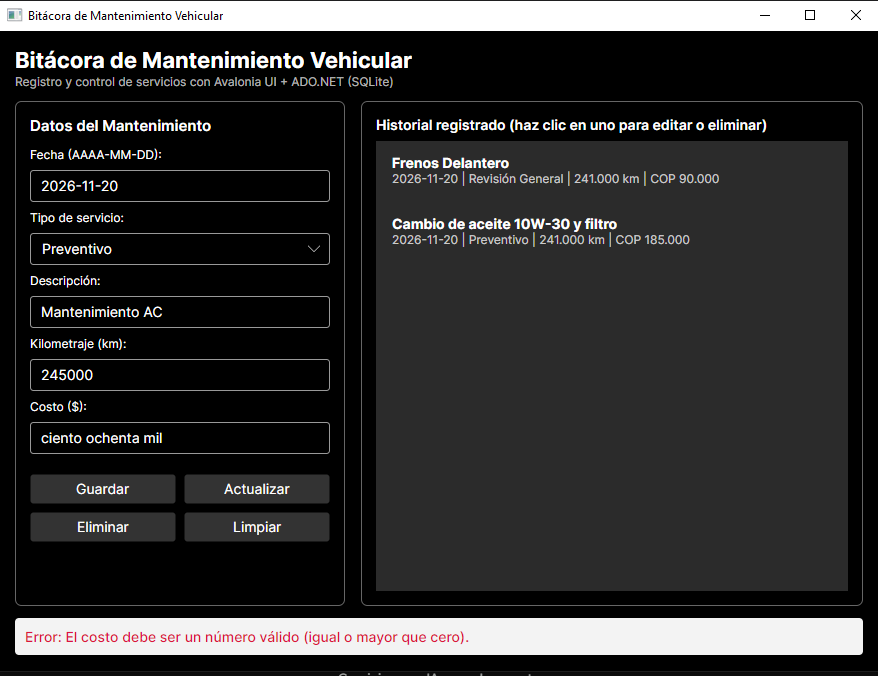

# Bitácora de Mantenimiento Vehicular (`BitacoraVehicular`)

## 1. Información general

- **Nombre del proyecto:** Bitácora de Mantenimiento Vehicular (`BitacoraVehicular`)
- **Estudiante:** Andrés Felipe Hernández Díaz
- **Asignatura:** Programación con C# y .NET
- **Descripción:** Aplicación de escritorio desarrollada en C# con Avalonia UI y ADO.NET (SQLite) para registrar, consultar, modificar y eliminar el historial de mantenimientos preventivos y correctivos de un vehículo.
- **Problema que resuelve:** Evita llevar el control de servicios, fechas, kilometrajes y costos en notas sueltas o papel, centralizando toda la información en una base de datos local persistente y fácil de administrar.
- **Objetivo principal:** Diseñar, desarrollar, probar y documentar una aplicación de escritorio que integre Programación Orientada a Objetos (POO), interfaz gráfica en Avalonia UI y persistencia de datos mediante ADO.NET y SQLite.

## 2. Funcionalidades

- **Registrar mantenimiento (Create):** Permite ingresar fecha, tipo de servicio, descripción, kilometraje y costo desde el formulario gráfico.
- **Consultar historial (Read):** Carga y muestra automáticamente todos los registros guardados en SQLite al abrir la aplicación, ordenados del más reciente al más antiguo.
- **Actualizar registro (Update):** Al seleccionar un elemento de la lista, sus datos se cargan en el formulario para editarlos y guardar los cambios en la base de datos.
- **Eliminar registro (Delete):** Borra el registro seleccionado tanto de la base de datos SQLite como de la vista.
- **Validación y notificaciones:** Valida el formato de fecha (`AAAA-MM-DD`), campos vacíos y valores numéricos antes de guardar, mostrando mensajes claros de éxito o error en la barra inferior sin que el programa se cierre.

## 3. Tecnologías utilizadas

- **Lenguaje:** C#
- **Framework:** .NET 10.0
- **Interfaz gráfica:** Avalonia UI 11 (XAML `.axaml`)
- **Acceso a datos:** ADO.NET (`Microsoft.Data.Sqlite`)
- **Base de datos:** SQLite
- **Entorno de desarrollo:** Visual Studio Code

## 4. Estructura del proyecto

```text
BitacoraVehicular/
├── Data/
│   ├── ConexionBD.cs              # Gestión de conexión a SQLite e inicialización de tabla
│   └── MantenimientoDAO.cs        # Operaciones CRUD con ADO.NET y SQL parametrizado
├── Models/
│   └── Mantenimiento.cs           # Entidad principal del dominio
├── Services/
│   └── MantenimientoServicio.cs   # Reglas de negocio y validaciones de entrada
├── evidencias/                    # Capturas de pantalla de pruebas funcionales
├── App.axaml                      # Configuración general de Avalonia
├── App.axaml.cs
├── MainWindow.axaml               # Diseño de la interfaz gráfica
├── MainWindow.axaml.cs            # Manejo de eventos y comunicación con la capa de servicio
├── Program.cs                     # Punto de entrada de la aplicación
├── BitacoraVehicular.csproj       # Archivo de proyecto y dependencias NuGet
├── .gitignore                     # Exclusión de bin/, obj/ y archivos temporales
└── README.md                      # Documentación técnica
```

### Diagrama de clases (UML)



### Clases principales, POO e integración entre capas

- **`Mantenimiento` (`Models/`):** Representa cada servicio realizado al vehículo personal del usuario (se diseñó como entidad única enfocada en un solo vehículo para mantener el modelo claro y directo). Aplica **encapsulamiento** mediante propiedades, **sobrecarga de constructores** y una propiedad calculada (`DetalleResumen`).
- **`ConexionBD` (`Data/`):** Encapsula la cadena de conexión (`private readonly`) y asegura la creación automática de la base de datos y la tabla.
- **`MantenimientoDAO` (`Data/`):** Centraliza el acceso a datos con ADO.NET y consultas parametrizadas. No contiene lógica visual ni validaciones de formulario.
- **`MantenimientoServicio` (`Services/`):** Implementa las reglas de negocio y validaciones antes de tocar la base de datos.
- **`MainWindow` (`MainWindow.axaml.cs`):** Captura los eventos de Avalonia y actualiza la interfaz.

**Ejemplo de flujo de integración (al presionar "Guardar"):**

1. `MainWindow` captura el evento `BtnGuardar_Click` y envía los textos ingresados a `MantenimientoServicio.Registrar(...)`.
2. `MantenimientoServicio` valida formato de fecha, campos obligatorios y rangos numéricos; si todo es válido, instancia un objeto `Mantenimiento`.
3. `MantenimientoDAO.Insertar(...)` solicita una `SqliteConnection` a `ConexionBD`, arma el `SqliteCommand` con parámetros `@` y ejecuta `ExecuteNonQuery()`.
4. `MainWindow` recarga la lista desde SQLite y muestra la notificación de confirmación (o atrapa la excepción y muestra el error en rojo sin cerrarse).

## 5. Instalación de dependencias

### Requisitos previos

- SDK de **.NET 10.0** o superior instalado en el equipo.

### Paquetes NuGet utilizados

- `Avalonia` / `Avalonia.Desktop` / `Avalonia.Themes.Fluent` (interfaz gráfica)
- `Microsoft.Data.Sqlite` (proveedor ADO.NET para SQLite)

### Pasos para preparar el entorno

1. Clonar el repositorio desde GitHub:

   ```bash
   git clone https://github.com/itohdez/BitacoraVehicular.git
   ```

2. Ingresar a la carpeta del proyecto:

   ```bash
   cd BitacoraVehicular
   ```

3. Restaurar las dependencias del proyecto:

   ```bash
   dotnet restore
   ```

No se requiere instalar motores externos ni realizar configuraciones adicionales.

## 6. Ejecución del programa

Desde la raíz de la carpeta `BitacoraVehicular`, ejecutar:

```bash
dotnet restore
dotnet run
```

Al iniciar, se abrirá la ventana principal de la aplicación lista para usar.

## 7. Base de datos

- **Información almacenada:** Historial de mantenimientos vehiculares (fecha, tipo de servicio, descripción, kilometraje y costo).
- **Motor y archivo:** SQLite almacenado localmente en el archivo `bitacora.db` (ubicado en el directorio de ejecución de la aplicación).
- **Inicialización automática:** No es necesario ejecutar scripts externos. Al instanciar `ConexionBD`, se ejecuta `CREATE TABLE IF NOT EXISTS Mantenimientos (...)`, creando la base de datos y la tabla automáticamente en el primer arranque.
- **Tabla `Mantenimientos`:**

  | Campo | Tipo SQLite | Descripción |
  | :--- | :--- | :--- |
  | `Id` | `INTEGER PRIMARY KEY AUTOINCREMENT` | Identificador único del registro |
  | `Fecha` | `TEXT NOT NULL` | Fecha del servicio (`AAAA-MM-DD`) |
  | `Tipo` | `TEXT NOT NULL` | Categoría (Preventivo, Correctivo, Revisión General) |
  | `Descripcion` | `TEXT NOT NULL` | Detalle del trabajo realizado |
  | `Kilometraje` | `INTEGER NOT NULL` | Kilometraje del vehículo al momento del servicio |
  | `Costo` | `REAL NOT NULL` | Costo total del mantenimiento |

- **Conexión y CRUD:** La conexión se gestiona en `Data/ConexionBD.cs` con `SqliteConnection`, y las cuatro operaciones CRUD (`Insertar`, `ObtenerTodos`, `Actualizar`, `Eliminar`) están implementadas en `Data/MantenimientoDAO.cs` usando `SqliteCommand`, parámetros `@` y bloques `using` para liberar recursos correctamente.

## 8. Evidencias de funcionamiento

### 1. Registro (Create)

Se completan los campos del formulario con datos válidos y se presiona **Guardar**. El registro se guarda en SQLite, aparece en la lista y se muestra el mensaje de confirmación.


### 2. Consulta (Read)

Se visualizan en la lista los registros almacenados en la base de datos con su descripción, fecha, tipo, kilometraje y costo.


### 3. Actualización (Update)

Se selecciona un registro existente de la lista, se modifican sus datos en el formulario y se presiona **Actualizar**. Los cambios se guardan y se reflejan de inmediato.


### 4. Eliminación (Delete)

Se selecciona un registro y se presiona **Eliminar**. El registro se borra de la base de datos y desaparece de la lista.


### 5. Validación de errores

Se intenta registrar información inválida (por ejemplo, kilometraje negativo o texto en campos numéricos). El sistema intercepta la excepción y muestra el mensaje de error en rojo sin cerrarse.


### 6. Persistencia

Se cierra completamente la aplicación y se vuelve a ejecutar con `dotnet run`. Los registros guardados previamente siguen disponibles al cargar la ventana.


## 9. Problemas encontrados y soluciones

- **Problema 1 (Advertencias `AVLN5001` por propiedades obsoletas en Avalonia):** Al compilar y ejecutar el proyecto en .NET 10, Avalonia reportó advertencias `AVLN5001` indicando que `TextBox.Watermark` está obsoleto.
  - **Solución:** Se reemplazó `Watermark` por `PlaceholderText` en todos los controles `TextBox` de `MainWindow.axaml`, logrando una compilación limpia con 0 errores y 0 advertencias.
- **Problema 2 (Recorte de controles y contraste en modo oscuro):** En la primera ejecución, el formulario quedaba cortado en la parte inferior ocultando los botones CRUD, y la barra de estado mostraba texto claro sobre fondo claro por el tema oscuro del sistema operativo.
  - **Solución:** Se aumentó el tamaño de la ventana (`880x640`), se envolvió el formulario en un `ScrollViewer` para garantizar acceso a todos los controles y se fijó `Foreground="#222222"` en el `TextBlock` de mensajes para asegurar legibilidad en cualquier tema.
- **Problema 3 (Compiled Bindings en `DataTemplate`):** Al enlazar las propiedades de `Mantenimiento` dentro del `ListBox`, Avalonia exige tipado explícito por tener *Compiled Bindings* activos por defecto.
  - **Solución:** Se declaró `xmlns:models="using:BitacoraVehicular.Models"` y `x:DataType="models:Mantenimiento"` en el `DataTemplate` de `MainWindow.axaml`.
